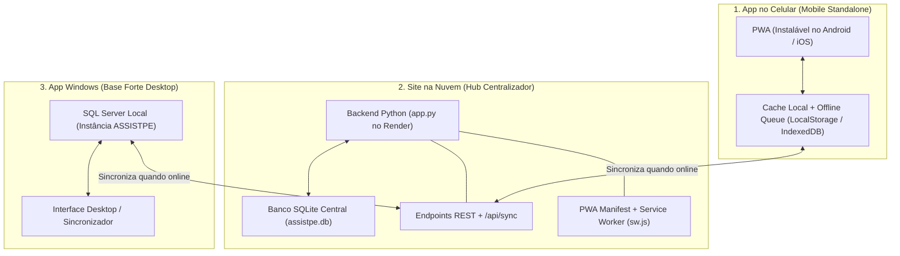

# 🤖 Assistente Pessoal - ARPego - Contexto, Decisões e Diretrizes

Documento vivo de alinhamento com todas as decisões arquiteturais, preferências operacionais, regras de negócio, estilo de desenvolvimento e histórico consolidado do projeto.

---

## 🧭 1. Diretrizes Operacionais e Preferências do Usuário

1. **Papel do Assistente (Gerente Pessoal de Tarefas & Produtividade):**
   - Atuar estritamente como **Gerente Pessoal de Tarefas**, com foco absoluto em manter o usuário ativo, focado e altamente produtivo.
   - Monitorar prazos, alertar sobre bloqueios, cobrar retornos, organizar pendências e não deixar nenhuma peteca cair.
   - **NÃO analisar código-fonte de sistemas corporativos (ABAP/queries/etc.)**, exceto se o usuário pedir expressamente. A execução técnica pertence ao usuário; a IA gerencia a esteira de entregas e mantém as bases 100% sincronizadas.
2. **Restrição Estrita de Ferramentas (ZERO Terminal):**
   - **NUNCA executar comandos de terminal (`run_command`):** Evita popups invasivos de autorização e atrito na IDE. Todas as inspeções e modificações de código devem ser feitas estritamente via ferramentas de leitura e edição de arquivos.
3. **Fluxo de Deploy (GitHub -> Render):**
   - Repositório: [`renato-pego/arpego`](https://github.com/renato-pego/arpego).
   - Produção Cloud: [https://arpego-9p4x.onrender.com/](https://arpego-9p4x.onrender.com/)
   - Atualizações em produção são publicadas pelo usuário via *"Upload files"* no GitHub, acionando o build automático no Render.
4. **Privacidade e Isolamento:**
   - Não realizar varreduras em pastas locais fora do projeto.
   - Todos os arquivos do projeto residem exclusivamente em: `c:\Users\renat\OneDrive\Documentos\AssistentePessoal\`.
5. **Estilo de Comunicação:**
   - Respostas diretas, objetivas, em português, destacando decisões tomadas e passos práticos.

---

## 🏛️ 2. Arquitetura do Pacote em 3 Partes (Tri-Camada)

O ecossistema ARPego é projetado em uma arquitetura **Hub & Spoke / Offline-First**:

1. **Parte 1 - App no Celular (Mobile PWA Offline-First):**
   - Funciona standalone: abre com ícone próprio na tela de início do celular.
   - Funciona 100% sem internet (abre em modo avião, mostra lista completa de tarefas e permite marcar conclusões ou cadastrar novas).
   - Alterações offline são guardadas em fila local e sincronizadas com a nuvem assim que detecta sinal de rede.
2. **Parte 2 - Site na Nuvem (Render Centralizador):**
   - Centralizador de informações e resolutor de conflitos.
   - Distribui o aplicativo PWA (botão nativo *"Instalar App"* no navegador).
   - Fornece rota de sincronização unificada (`POST /api/sync`) para o celular e para o computador.
3. **Parte 3 - App Windows (Base Forte Desktop Stand Alone):**
   - **Inicialização Direta do Atalho (Zero Terminal):** O atalho oficial abre diretamente a interface gráfica em janela nativa (Edge/Chrome App Mode na porta `5050`), sem passar por menus ou seletores em texto.
   - **Matriz de Conectividade Inteligente:**
     1. *SQL Inativo & Offline:* Exibe alerta nativo do Windows explicando a ausência de banco local e de rede, e **não abre** a tela.
     2. *SQL Inativo & Nuvem Online:* Abre diretamente consumindo dados em tempo real da Nuvem (`☁️ Modo Nuvem`).
     3. *SQL Ativo & Offline:* Abre diretamente com dados do banco local (`⚡ Base Forte Local`).
     4. *SQL Ativo & Nuvem Online:* Executa a **sincronização automática imediata** e abre com ambos sincronizados (`🟢 Online & Sincronizado`).
   - **Identidade Visual Idêntica ao Celular:** Mesmos cards de tarefas, visual escuro, filtros compactos e cumulativos, crachás de prioridade e modal do Guia Visual de Cores.
   - **Governança Exclusiva de Domínios:** Aba `[⚙️ Gerenciar Domínios]` para cadastrar e trocar cores de Status e Prioridades diretamente no SQL Server.

---

## ⚙️ 3. Regras de Negócio e Decisões de Design (UI/UX)

### 3.1. Regra de Recursividade das Tarefas (Corte às 04:00 BRT)
- **Marco Zero do Dia:** O "dia de tarefas" reinicia diariamente às **04:00 da manhã (Horário de Brasília / UTC-3)**.
- **Tarefa Diária (1 dia):** Finalizada às 21:00 (ou em qualquer momento até 03:59), retorna automaticamente a **Pendente** no próximo corte das **04:00**.
- **Tarefa de N Dias:** Retorna a **Pendente** após N dias, pontualmente às **04:00**.
- **Indicação Visual:** Tarefas concluídas com recorrência exibem o selo: `🔄 Volta em DD/MM às 04:00`.
- **Prevenção de Fuso:** Utilização estrita de `timezone(timedelta(hours=-3))` para impedir que o relógio UTC do Render faça a data virar às 21:00 do Brasil.

### 3.2. Card de Filtros Compacto & Cumulativo (4 Elementos - Otimizado para Mobile)
- Estrutura enxuta e econômica para telas de celular (altura mínima sem empilhar cards):
  1. **Filtro por:** 1º Combo (~45-48% da largura da tela) definindo o critério (*Status*, *Projeto / Cliente*, *Prioridade* ou *Filtro por...*). Mostra o status ativo no próprio texto (ex: `⚡ Status (Em andamento)`).
  2. **Chave do filtro:** 2º Combo (~45-48% da largura da tela) preenchido dinamicamente com as opções do critério selecionado, preservando o valor ativo.
  3. **Comportamento Cumulativo (E / AND):** Selecionar *Status: Em andamento* e depois trocar para *Prioridade: Alta* mantém **ambos os filtros ativos simultaneamente**.
  4. **Tags Visuais Interativas:** Exibe chips rápidos de filtros ativos (`[⚡ Em andamento ✕] [🎯 Alta ✕]`) permitindo remover cada critério individualmente.
  5. **Botão ✕ Limpar:** Exibe o total de filtros ativos (ex: `✕ Limpar (2)`) e restaura instantaneamente todos os registros.
  6. **Botão ➕ Nova Tarefa:** Abre o formulário de cadastro rápido.

### 3.3. Campo Projeto / Cliente Aberto + Autocomplete
- O campo utiliza `<input list="projetos-list">` tanto na criação quanto na edição.
- Traz projetos existentes sugeridos e **permite digitar livremente um novo projeto**.
- Novos projetos digitados são cadastrados automaticamente na tabela `tb_projetos`.

### 3.4. Cofre Seguro de Credenciais (Vault Zero-Knowledge)
- Criptografia simétrica client-side **AES-256-GCM** com derivação de chave **PBKDF2 (100.000 iterações)** via Web Crypto API.
- Desbloqueado unicamente via PIN mestre de 4 dígitos no navegador.
- O servidor recebe e armazena apenas `senha_cifrada`, `iv` e `salt` — **zero conhecimento** das senhas em texto puro.

### 3.5. Identidade Visual e Guia Interativo de Cores
- O cabeçalho exibe o ícone oficial do mascote robô azul (`/icon.svg`).
- Ao clicar no ícone ou no título do cabeçalho, abre o modal **"Guia Visual de Cores"**, detalhando em tempo real:
  1. Faixa lateral esquerda (Status de andamento).
  2. Crachás de prioridade (Urgência: Alta, Média, Baixa).
  3. Indicadores especiais (Recorrência às 04:00 BRT e código único).

### 3.6. Governança de Domínios (Status & Prioridades Centralizados)
- **Manutenção Exclusiva no Windows Desktop:** O cadastro, alteração de nomes e customização de cores de Status e Prioridades é gerenciado **exclusivamente na Base Forte Windows (SQL Server)** via menu `[7] ⚙️ Gerenciar Domínios`.
- **Consumo Dinâmico no Celular (Zero Hardcode):** O celular e a aplicação web não possuem telas de manutenção de domínio, mantendo o app focado em produtividade e sem poluição visual.
- **Single Source of Truth:** O celular consome a lista oficial via `/api/dominios` e sincronização `/api/sync`, armazenando no cache local para funcionamento offline (0ms). Todos os componentes (bordas dos cards, seletores suspensos, tags de prioridade, filtros e guia visual) são renderizados dinamicamente a partir dos objetos `STATUS_CONFIG` e `PRIORITY_CONFIG`.

### 3.7. Radar de E-mails & SLA de Resposta (Outlook MAPI Desktop)
- **Integração COM MAPI Nativa:** Lê em tempo real as Caixas de Entrada de todas as contas ativas no Microsoft Outlook Desktop (`renato.l.pego@outlook.com`, `gmail.com`, `soenergy.com`, `boadigital.com.br`) sem necessidade de senhas ou chaves externas.
- **Vínculo Automático com Tarefas:** Correlaciona palavras-chave e clientes (*Boa*, *IFF*, *Krom*, *Follow Up*, *Caldic*, *Unimed*, etc.) e grava notas automáticas no histórico (`tb_historico`).
- **Detecção de Novas Demandas:** Identifica solicitações de chamados ou erros reportados e alimenta a fila de sugestões para aprovação com 1 clique.
- **Cálculo de SLA Anti-Esquecimento:**
  - 🟡 **Atenção:** Mensagem sem resposta há mais de 2 horas.
  - 🟠 **Alerta:** Mensagem sem resposta há mais de 4 horas.
  - 🔴 **Crítico:** Mensagem sem resposta há mais de 8 horas (destaque em banner no topo do painel de tarefas).
- **Varredura Contínua:** Thread silenciosa em segundo plano executada a cada 10 minutos no `app_windows.py`.

### 3.8. Governança de Apontamentos de Horas (IADBMNG & PSOffice)
- **Papel de Governança (Sem fusão de apps):** O Assistente Pessoal atua como **Auditor e Gerente Ativo de Apontamentos**, monitorando o banco `IADBMNG` (`localhost` MSSQL / SQLite) sem interferir no app `c:\IADBMNG`.
- **Cobrança Ativa de Horas Diárias:** Monitora a meta diária (8.0h por dia útil). Se o usuário não tiver apontado o dia de hoje ou dias anteriores, emite alertas e sugestões imediatas.
- **Sugestão de Lançamentos Baseada nas Tarefas:** Relaciona as frentes executadas no dia (ex: `#024` Boa, `#025` IFF, `#026` IFF) e propõe o rateio e descritivo exato para preenchimento ágil.
- **Auditoria de PSOffice:** Sinaliza lançamentos com status `sem_tarefa` ou `nao_lancado` para evitar retrabalho no fechamento mensal.

---

## 📊 4. Estrutura de Dados e Esquema de Tabelas

### 4.1. SQLite Cloud (`assistpe.db`) & SQL Server (`ASSISTPE`)
- **`tb_projetos`:** `id`, `nome`, `sigla`, `tipo` (Profissional / Pessoal).
- **`tb_tarefas`:**
  - `id`, `codigo` (`#001` profissional, `#P01` pessoal)
  - `id_projeto`, `titulo`, `tipo`, `prioridade`, `status`, `observacoes`
  - `recorrencia_dias` (0 = avulsa, 1 = diária, etc.)
  - `data_conclusao` (TIMESTAMP BRT)
  - `data_recorrencia` (TIMESTAMP BRT de reinício às 04:00)
- **`tb_emails_monitorados`:** `id`, `entry_id`, `conta`, `remetente`, `remetente_email`, `assunto`, `data_recebimento`, `codigo_tarefa_vinculada`, `status_processamento`, `precisa_resposta`, `respondido`, `horas_sem_resposta`, `sla_status`, `corpo_resumo`, `data_processamento`.
- **`tb_sugestoes_tarefas`:** `id`, `email_entry_id`, `titulo`, `projeto`, `prioridade`, `tipo`, `resumo`, `status`, `data_criacao`.
- **`tb_credenciais`:** `id`, `categoria`, `titulo`, `usuario`, `senha_cifrada`, `iv`, `salt`, `observacoes`.
- **`tb_historico`:** `id`, `codigo_tarefa`, `descricao`, `data_hora`.
- **`tb_historico`:** `id`, `codigo_tarefa`, `descricao`, `data_hora`.

---

## 📋 5. Radar de Prioridades e Backlog Ativo

| ID | Frente / Cliente | Tarefa | Prioridade | Status | Observações |
|:---:|:---|:---|:---:|:---:|:---|
| **#024** | Boa | Criação do Follow UP sem EIC | Alta | 🔵 Em andamento | Criar novo módulo de importação. Indo muito bem. |
| **#025** | IFF Brasil / México | Refatorar ABAP interface de pedido | Alta | 🔵 Em andamento | Apareceu um erro na interface de pedido. Refatorar e debugar rotina. |
| **#026** | IFF Brasil / México | Erro na carga do TXT da Krom | Alta | 🔵 Em andamento | Investigar e corrigir erro na carga do TXT da despachante Krom. |
| **#018** | Caldic | Atualizar produção | Alta | 🔵 Em andamento | Deploy em produção. |
| **#022** | Caldic | Refatorar integração de pedidos | Alta | Não iniciada | Campo posição não foi preenchido na integração. |
| **#007** | IFF México | Validar lançamentos contábeis com Joel | Alta | Aguardando | Alinhamento com Joel. |
| **#010** | IFF Brasil/México | Carregar tabela de vias de Transporte | Média | Aguardando dados | Aguardando planilha. |
| **#011** | IFF Brasil/México | Buscar DOC CFIN com erro | Alta | Aguardando retorno | Detalhes com usuários. |
| **#003** | IFF Argentina | Ativar e-mail de data de chegada (ZS) | Média | ✅ Concluída | Validada em produção! E-mail disparado com sucesso (Processo A015300020115). |
| **#004** | IFF Brasil/México | Código e descrição do Material no e-mail (ZS) | Média | ✅ Concluída | Validada em produção! Código e descrição exibidos no e-mail do ZS. |
| **#015** | Unimed | Correção da interface de fornecedores com MV | Alta | 🟢 Em testes | Aguardando testes MV. |
| **#016** | Unimed | Interface de NF com 2 pedidos | Alta | 🟢 Em testes | Validação de múltiplos pedidos. |
| **#017** | Eurofarma | Aplicar melhorias da Caldic | Média | Aguardando Caldic | Replicar após estabilização. |
| **#P01** | Pessoal | Fazer Duolingo | Média | 🔄 Diária (04h) | Concluída hoje. Próximo ciclo: 23/10 04:00. |
| **#P02** | Pessoal | Caminhada, calistênica | Alta | 🔄 Diária (04h) | Concluída hoje. Próximo ciclo: 23/10 04:00. |
